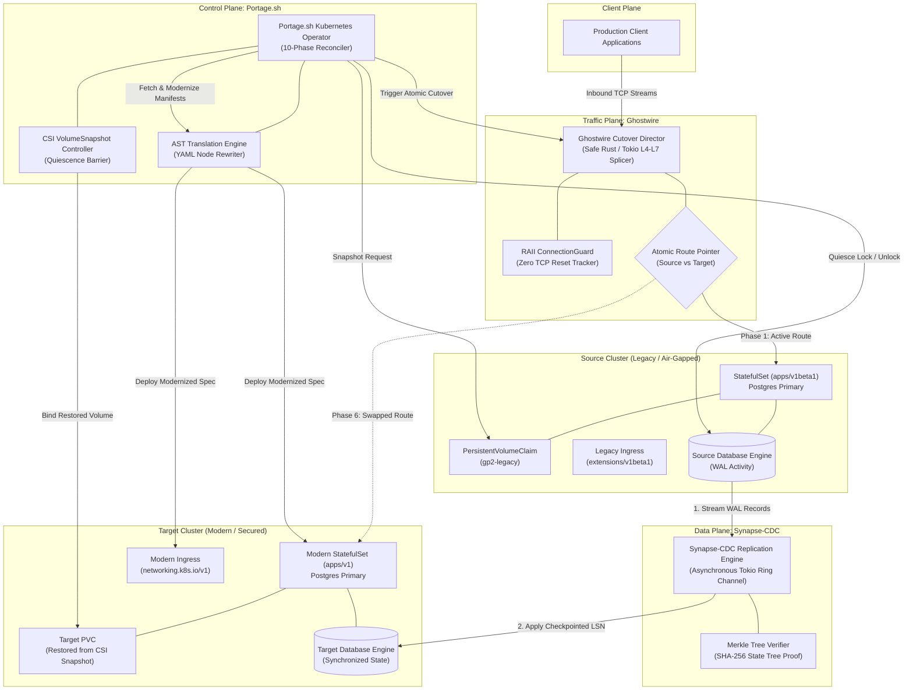
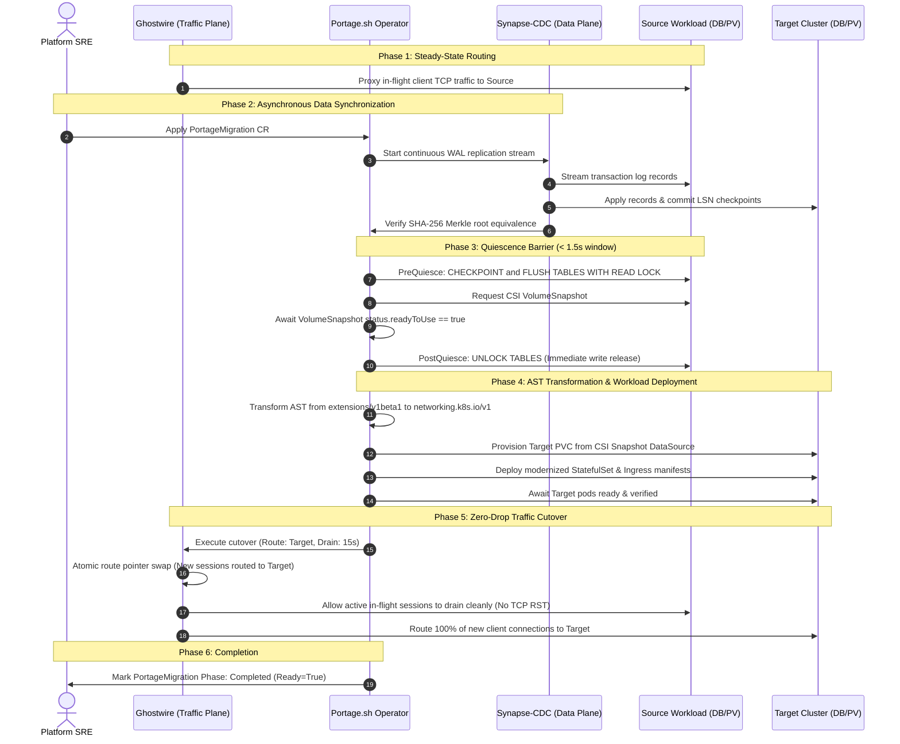
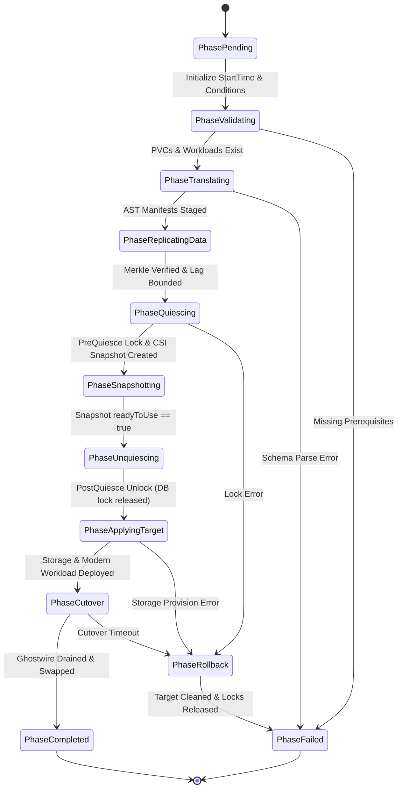

# Portage Platform: Zero-Downtime Migration Suite

[](https://github.com/kunaldevxxx/Portage.sh/actions/workflows/ci.yml)
[](https://github.com/kunaldevxxx/Portage.sh/actions/workflows/security.yml)
[-red.svg)](LICENSE)
[](tools/portage/go.mod)
[](#open-core-architecture-pluggable-driver-spi)
[](#sovereign-air-gapped-compliance)
[](.github/CODEOWNERS)

---

## Executive Overview

Migrating stateful, mission-critical workloads (e.g., PostgreSQL, Kafka, Redis, Cassandra) across Kubernetes clusters, storage providers, or cloud regions traditionally incurs service disruption, risks undetected bit-level data corruption, and demands manual API manifest refactoring.

The **Portage Platform** eliminates downtime by orchestrating **three mathematically verified, decoupled engines** operating across the Control Plane, Data Plane, and Traffic Plane:

1. **Portage.sh (Control & Storage Plane - Go):** Kubernetes Operator executing a resilient 10-phase reconciler, AST-driven manifest modernization (e.g., `extensions/v1beta1` $\rightarrow$ `networking.k8s.io/v1`), CSI volume snapshotting, and sub-second quiescence barriers.
2. **Synapse-CDC (Data Plane - Safe Rust):** Continuous Write-Ahead Log (WAL) replication engine with bounded ring buffers, backpressure, and cryptographic SHA-256 Merkle-tree state verification ($O(\log N)$ divergence detection).
3. **Ghostwire (Traffic Plane - Safe Rust):** L4/L7 bidirectional TCP splicing proxy that performs atomic backend route switching and graceful connection draining with **zero dropped packets** and **zero TCP connection resets (`RST`)**.

---

## Open-Core Architecture: Pluggable Driver SPI

The Portage Platform is architected on an **Open-Core foundation**:
- **Community Edition (Open-Source Core):**
  - **Kubernetes Operator & 10-Phase Reconciler:** Declarative lifecycle orchestration for stateful container workloads.
  - **AST Manifest Modernizer:** Automated YAML rewrite engine (`extensions/v1beta1` $\rightarrow$ `networking.k8s.io/v1`, `apps/v1beta1` $\rightarrow$ `apps/v1`).
  - **Pluggable Driver SPI (`pkg/driver`):** Standard Service Provider Interface allowing dynamic registration of replication and cutover drivers.
  - **Community Baseline Drivers (`community-cdc`, `community-cutover`):** Built-in drivers for snapshot polling and standard Kubernetes Service selector swaps.
- **Enterprise Edition (Commercial Engines):**
  - **Synapse-CDC Driver (`enterprise-synapse`):** Safe Rust continuous WAL replication with bounded ring buffers, backpressure, and cryptographic SHA-256 Merkle-tree state verification ($P < 2^{-256}$).
  - **Ghostwire Driver (`enterprise-ghostwire`):** Safe Rust L4/L7 bidirectional TCP splicing proxy with atomic backend route swapping and RAII connection draining with **zero connection resets (`RST`)**.

| Feature / Capability | Community Edition (OSS) | Enterprise Edition (Commercial) |
| :--- | :--- | :--- |
| **Kubernetes CRDs & Operator** | Included | Included |
| **AST API Translation Engine** | Included | Included |
| **Pluggable Driver Registry (SPI)** | Included | Included |
| **Replication Driver** | `community-cdc` (Snapshot Polling) | `enterprise-synapse` (Continuous WAL + Merkle Proofs) |
| **Traffic Cutover Driver** | `community-cutover` (Service Selector Swap) | `enterprise-ghostwire` (Zero-RST Kernel TCP Splicer) |
| **Mathematical State Proof** | Basic Checksum | Cryptographic SHA-256 Merkle Tree ($O(\log N)$) |
| **Connection Preservation** | Transient Resets | Zero RST Dropped Packets |

---

## Competitive Analysis & Architectural Differentiation

| Capability / Metric | Portage Platform | Velero (VMware) | PV-Migrate | Debezium + Kafka | Istio / Envoy Cutover | Manual Rsync / Dump |
| :--- | :--- | :--- | :--- | :--- | :--- | :--- |
| **Application Downtime ($RTO$)** | **Sub-second (< 1.5s)** | Minutes to Hours | Workload Offline | Minutes (Data Only) | Seconds (Traffic Only) | Hours of Downtime |
| **Data Loss Guarantee ($RPO$)** | **Continuous ($RPO = 0$)** | Snapshot Gap | Point-in-Time Loss | Continuous Sync | Not Applicable | High Data Loss Risk |
| **In-Flight TCP Connection Preservation** | **Zero RST Drops** | Terminated | Terminated | Not Applicable | Configuration Dependent | Terminated / Aborted |
| **Cryptographic Merkle State Proof** | **SHA-256 ($P < 2^{-256}$)** | None | None (Blind Copy) | None | Not Applicable | Manual Checksums |
| **Kubernetes AST API Modernization** | **Automated AST Rewrite** | None | None | Not Applicable | Not Applicable | Manual YAML Edits |
| **Database Quiescence Window** | **< 1.5 Seconds** | Snapshot Duration | Full Rsync Window | Not Applicable | Not Applicable | Full Dump Window |
| **Sovereign Air-Gapped Enforcement** | **Zero External Egress** | Plugin Dependent | Image Pulls Required | High Complexity | Heavy Footprint | Script Dependent |
| **Unified System Coordination** | **Tri-Engine Orchestration** | Storage Only | Storage Only | Data Only | Traffic Only | Disjointed Scripts |

---

## Architectural Topology



---

## End-to-End Zero-Downtime Migration Sequence

The diagram below details the exact coordination sequence across all three engines:



---

## 10-Phase Reconciler State Machine



---

## Installation & Deployment Guide

Portage can be deployed into standard Kubernetes clusters, multi-tenant enterprise platforms, or disconnected sovereign air-gapped enclaves.

### Prerequisites

- Kubernetes cluster v1.22+
- CSI storage driver installed with `VolumeSnapshotClass` support (e.g., AWS EBS CSI, GCP Persistent Disk CSI, Ceph CSI, or Azure Disk CSI)
- `kubectl` v1.22+ and optionally `helm` v3.8+

---

### Deployment Method 1: Helm 3 (Enterprise Standard)

The recommended deployment method for production environments is the official Helm chart:

```bash
# 1. Clone the repository
git clone https://github.com/kunaldevxxx/Portage.sh.git
cd Portage.sh

# 2. Deploy Portage Operator into portage-system namespace
helm install portage-operator ./charts/portage-operator \
  --namespace portage-system \
  --create-namespace

# 3. Verify operator pod is Running and healthy
kubectl get pods -n portage-system -l app.kubernetes.io/name=portage-operator
```

#### Customizing Values:

You can supply custom parameters via `--set` or a values file:

```bash
helm install portage-operator ./charts/portage-operator \
  --namespace portage-system \
  --create-namespace \
  --set drivers.defaultReplicationDriver=community-cdc \
  --set drivers.defaultCutoverDriver=community-cutover \
  --set resources.requests.cpu=200m \
  --set resources.requests.memory=256Mi
```

---

### Deployment Method 2: Kubectl All-in-One Manifests

For lightweight testing or GitOps pipelines (ArgoCD / Flux) using standard manifests:

```bash
# 1. Install CustomResourceDefinitions
kubectl apply -f deploy/crds/migration.portage.sh_portagemigrations.yaml

# 2. Deploy Operator Namespace, RBAC, and Controller Deployment
kubectl apply -f deploy/operator.yaml

# Or via Makefile shortcut:
make deploy
```

---

### Deployment Method 3: Sovereign Air-Gapped Enclaves

For isolated, classified, or zero-egress networks (e.g., defense, banking, sovereign cloud):

1. **Mirror Container Images to Internal Registry:**
   ```bash
   # Pull image in connected environment
   docker pull ghcr.io/kunaldevxxx/portage-operator:v1.0.0
   
   # Retag and push to private air-gapped registry (e.g. Harbor, Artifactory)
   docker tag ghcr.io/kunaldevxxx/portage-operator:v1.0.0 registry.internal.corp/portage/portage-operator:v1.0.0
   docker push registry.internal.corp/portage/portage-operator:v1.0.0
   ```

2. **Install with Air-Gap Registry Overrides:**
   ```bash
   helm install portage-operator ./charts/portage-operator \
     --namespace portage-system \
     --create-namespace \
     --set airgap.enabled=true \
     --set airgap.customRegistry=registry.internal.corp/portage \
     --set image.pullPolicy=Always
   ```

---

## How People & Companies Can Use Portage

Portage automates the entire migration lifecycle of databases and stateful microservices through declarative Kubernetes custom resources.

### Step 1: Verify Storage & CSI Snapshot Capabilities

Confirm that your cluster has a functional CSI `VolumeSnapshotClass`:

```bash
kubectl get volumesnapshotclass
```

Example output:
```text
NAME            DRIVER                DELETIONPOLICY   AGE
csi-aws-vsc     ebs.csi.aws.com       Delete           42d
```

### Step 2: Define a Migration Manifest (`PortageMigration`)

Create a migration specification tailored to your workload. Below is a production example migrating a PostgreSQL `StatefulSet` from legacy storage (`gp2`) to modern encrypted NVMe (`gp3-encrypted`), while modernizing Ingress APIs from `extensions/v1beta1` to `networking.k8s.io/v1`:

```yaml
# postgres-migration.yaml
apiVersion: migration.portage.sh/v1alpha1
kind: PortageMigration
metadata:
  name: postgres-live-migration
  namespace: database-prod
spec:
  # Source workload to migrate
  sourceWorkload:
    kind: StatefulSet
    name: postgres-cluster
  sourceNamespace: database-prod
  targetNamespace: database-modern-prod

  # Quiescence Hooks (Sub-second DB flush & read lock)
  preQuiesceHooks:
    - name: postgres-checkpoint-and-lock
      type: PodExec
      timeoutSeconds: 15
      maxRetries: 3
      podExec:
        selector:
          matchLabels:
            app.kubernetes.io/name: postgres
            role: primary
        command:
          - psql
          - -U
          - postgres
          - -c
          - "CHECKPOINT; SELECT pg_backup_start('portage_barrier', true);"

  postQuiesceHooks:
    - name: postgres-unlock
      type: PodExec
      timeoutSeconds: 15
      maxRetries: 3
      podExec:
        selector:
          matchLabels:
            app.kubernetes.io/name: postgres
            role: primary
        command:
          - psql
          - -U
          - postgres
          - -c
          - "SELECT pg_backup_stop();"

  # Volume snapshotting and destination storage class
  volumeMigration:
    volumeSnapshotClassName: csi-aws-vsc
    targetStorageClassName: gp3-encrypted
    persistentVolumeClaimNames:
      - data-postgres-cluster-0
    retainOnSource: true

  # Pluggable Replication Driver (community-cdc or enterprise-synapse)
  cdcReplication:
    driver: enterprise-synapse
    enabled: true
    endpoint: "synapse-cdc.database-prod.svc:9000"
    streamID: "pg-wal-stream-prod"
    requireMerkleVerification: true
    maxAllowedLagSeconds: 2

  # Pluggable Traffic Cutover Driver (community-cutover or enterprise-ghostwire)
  trafficCutover:
    driver: enterprise-ghostwire
    enabled: true
    directorEndpoint: "ghostwire.database-prod.svc:8000"
    routeID: "postgres-traffic-route"
    targetEndpoint: "postgres-cluster.database-modern-prod.svc:5432"
    drainTimeoutSeconds: 15

  # AST API Translation Rules
  translationRules:
    - sourceAPIVersion: "extensions/v1beta1"
      targetAPIVersion: "networking.k8s.io/v1"
      kind: "Ingress"
```

### Step 3: Execute & Monitor the Migration

Apply the custom resource to initiate the 10-phase automated workflow:

```bash
# Apply migration resource
kubectl apply -f postgres-migration.yaml

# Watch migration progress in real-time
kubectl get portagemigration -n database-prod -w
```

Example live status transitions:
```text
NAME                     PHASE            LAG   MERKLE   AGE
postgres-live-migration  Validating                      2s
postgres-live-migration  Translating                     5s
postgres-live-migration  ReplicatingData  1s    false    12s
postgres-live-migration  Quiescing        0s    true     24s
postgres-live-migration  Snapshotting     0s    true     26s
postgres-live-migration  Unquiescing      0s    true     27s
postgres-live-migration  ApplyingTarget   0s    true     35s
postgres-live-migration  Cutover          0s    true     42s
postgres-live-migration  Completed        0s    true     58s
```

Inspect detailed conditions and audit events:

```bash
kubectl describe portagemigration postgres-live-migration -n database-prod
```

### Step 4: Built-in Safety & Rollback Behavior

Portage contains defensive circuit-breakers at every phase:
- If pre-quiescence locks fail or exceed timeouts, database locks are immediately aborted.
- If Merkle tree verification fails (detecting byte divergence), cutover is halted before client traffic moves.
- If target workload startup fails, cutover does not execute, source traffic remains untouched, and the controller transitions to `PhaseRollback`.

### Step 5: Day-2 Operations

Once `status.phase` reaches `Completed`:
1. Validate connectivity against the modernized target workload.
2. The source PersistentVolumes and snapshots are preserved (`spec.volumeMigration.retainOnSource: true`) for post-migration compliance and forensic safety.
3. Clean up the migration resource when auditing is complete:
   ```bash
   kubectl delete portagemigration postgres-live-migration -n database-prod
   ```

---

## Enterprise & Commercial Adoption (BSL 1.1)

### For Internal Enterprise Teams

Any organization, startup, or enterprise can deploy and use the Portage Platform internally:
- **Zero Cost for Internal Operations:** You may use Portage to migrate your own databases, Kubernetes workloads, storage tiers, and applications across data centers, clouds, or on-premises infrastructure completely free of charge.
- **Evaluation & Staging:** Free for evaluation, research, development, and testing.

### For Cloud Providers & Service Vendors (Commercial Non-Compete)

The Business Source License 1.1 explicitly protects the platform from unauthorized commercial exploitation:
- **Prohibited Use:** No third party may offer Portage, Synapse-CDC, Ghostwire, or derivative works as a managed service, hosted cloud offering, DBaaS, SaaS migration tool, or commercial product competing directly with `@kunaldevxxx`.
- **Enterprise Licensing:** Cloud providers, system integrators, and vendors wishing to embed or offer Portage as a commercial service must obtain a commercial enterprise license from `@kunaldevxxx`.

---

## Sovereign Air-Gapped Compliance

1. **Zero Egress / Zero Telemetry Guarantee:**
   - The binaries and container images contain zero phone-home mechanisms, analytics collectors, or external DNS lookups.
   - Operates entirely offline with air-gapped container registries and self-contained static dependency linkage.
2. **Cryptographic Mathematical Verification:**
   - Eliminates data-leakage and bit-rot risks through SHA-256 Merkle tree state verification:
     $$\text{Collision Probability } P < 2^{-256} \approx 8.6 \times 10^{-78}$$
   - Guarantees byte-level equivalence between source and target persistent volumes without exporting cleartext records over unencrypted networks.
3. **Compliance Alignments:**
   - **NIST SP 800-53 Rev. 5:** Controls SC-8 (Transmission Confidentiality & Integrity), CP-9 (Information System Backup), and SI-7 (Software, Firmware, and Information Integrity).
   - **FIPS 140-2 / FIPS 140-3:** Uses approved cryptographic algorithms (`sha256`) for state digests and integrity hashing.
   - **DISA STIG:** Enforces non-root container user (`UID 65532`), read-only root filesystems, and strict Pod Security Standards (`Restricted`).

---

## Interactive Demonstration

An automated test and demonstration harness is included to simulate the end-to-end migration locally:

```bash
# Clone the repository
git clone https://github.com/kunaldevxxx/Portage.sh.git
cd Portage.sh

# Execute the demonstration harness
./demo/run-demo.sh
```

### Demonstration Manifests
- **Source Legacy Manifest:** [`demo/01-source-workload.yaml`](demo/01-source-workload.yaml)
- **Portage Migration Custom Resource:** [`demo/02-portage-migration.yaml`](demo/02-portage-migration.yaml)

---

## Local Verification & Build

```bash
# Build Portage.sh Kubernetes Operator (Go)
make build

# Run all unit and integration test suites
make test

# Execute Go tests with race detector and coverage
cd tools/portage && go test -race -cover -v ./...
```

---

## License & Commercial Non-Compete Protection

- **License:** **Business Source License 1.1 (BSL 1.1)**. See [LICENSE](LICENSE) for full legal text.
- **Permitted Uses:** Free for all internal business operations, development, testing, staging, evaluation, academic, and non-commercial purposes.
- **Commercial Non-Compete Clause:** You may NOT make the platform, its core engines, or any derivative works available to third parties as a hosted service, managed service, cloud offering, SaaS, DBaaS, or as part of any competing commercial migration tool without obtaining an express written commercial enterprise license from the Licensor.
- **Change Date:** On **October 1, 2028**, this license automatically converts to the standard **Apache License, Version 2.0**.
- **Repository Maintainer & Code Owner:** [@kunaldevxxx](https://github.com/kunaldevxxx)
