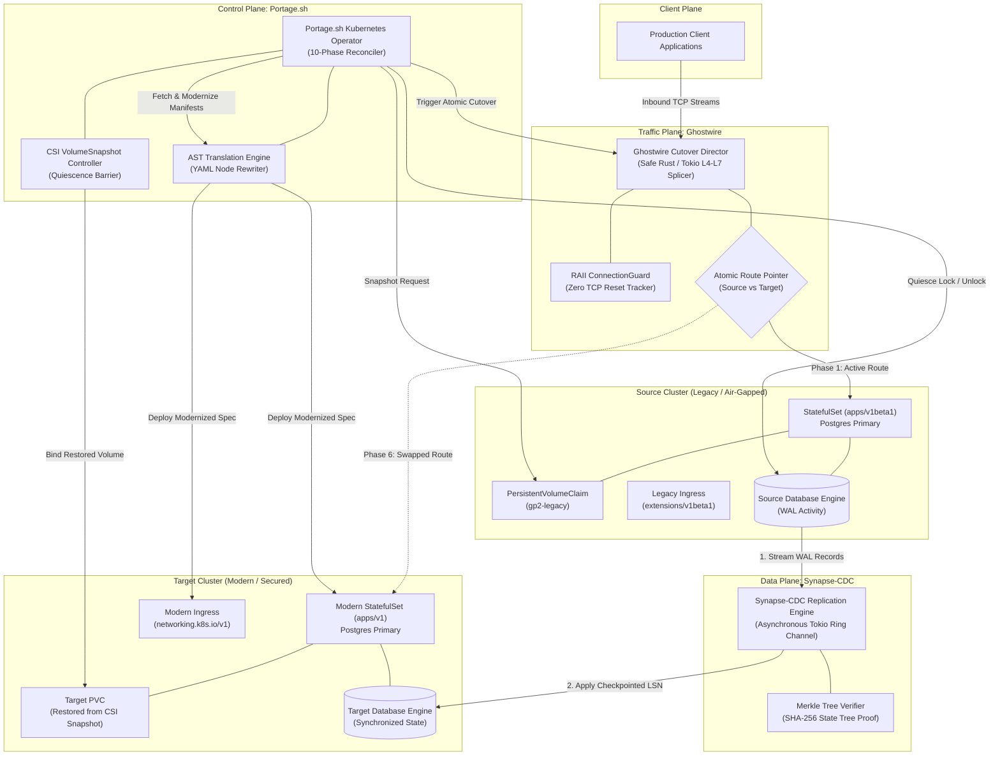
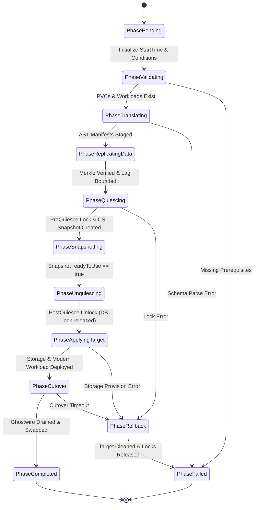

# Portage Platform: Enterprise Zero-Downtime Migration Suite

[](https://github.com/kunaldevxxx/Portage.sh/actions/workflows/ci.yml)
[](https://github.com/kunaldevxxx/Portage.sh/actions/workflows/security.yml)
[](LICENSE)
[](tools/portage/go.mod)
[](Cargo.toml)
[](#sovereign-air-gapped-compliance)
[](.github/CODEOWNERS)

---

## Executive Overview

Migrating stateful, mission-critical workloads (e.g., PostgreSQL, Kafka, Redis, Cassandra) across Kubernetes clusters, storage providers, or cloud regions traditionally incurs service disruption, risks undetected bit-level data corruption, and demands manual API manifest refactoring.

The **Portage Platform** eliminates downtime by orchestrating **three mathematically verified, decoupled engines** operating across the Control Plane, Data Plane, and Traffic Plane:

1. **Portage.sh (Control & Storage Plane - Go):** Kubernetes Operator executing a resilient 10-phase reconciler, AST-driven manifest modernization (e.g., `extensions/v1beta1` $\rightarrow$ `networking.k8s.io/v1`), CSI volume snapshotting, and sub-second quiescence barriers.
2. **Synapse-CDC (Data Plane - Safe Rust):** Continuous Write-Ahead Log (WAL) replication engine with bounded ring buffers, backpressure, and cryptographic SHA-256 Merkle-tree state verification ($O(\log N)$ divergence detection).
3. **Ghostwire (Traffic Plane - Safe Rust):** L4/L7 bidirectional TCP splicing proxy that performs atomic backend route switching and graceful connection draining with **zero dropped packets** and **zero TCP connection resets (`RST`)**.

---

## Competitive Analysis & Architectural Differentiation

| Capability / Metric | Portage Platform (Our Suite) | Velero (VMware) | PV-Migrate | Debezium + Kafka | Istio / Envoy Cutover | Manual Rsync / Dump |
| :--- | :---: | :---: | :---: | :---: | :---: | :---: |
| **Zero Application Downtime ($RTO \approx 0$)** | :white_check_mark: **Sub-second** | :x: Minutes / Hours | :x: Workload Offline | :warning: Data only | :warning: Traffic only | :x: Hours of Downtime |
| **Zero Data Loss Guarantee ($RPO = 0$)** | :white_check_mark: **Continuous Sync** | :x: Snapshot Gap | :x: Point-in-time | :white_check_mark: Continuous | :heavy_minus_sign: N/A | :x: Large Data Loss Gap |
| **In-Flight TCP Connection Preservation** | :white_check_mark: **Zero RST Drops** | :x: Terminated | :x: Terminated | :heavy_minus_sign: N/A | :warning: Config Dependent | :x: Terminated |
| **Cryptographic Merkle State Proof** | :white_check_mark: **SHA-256 ($P < 2^{-256}$)** | :x: None | :x: None (Blind Copy) | :x: None | :heavy_minus_sign: N/A | :x: Manual Checksums |
| **Kubernetes AST API Translation** | :white_check_mark: **Automated Ingress/Workload** | :x: None | :x: None | :heavy_minus_sign: N/A | :heavy_minus_sign: N/A | :x: Manual YAML Edits |
| **Database Quiescence Window** | :white_check_mark: **< 1.5 Seconds** | :x: Snapshot Duration | :x: Full Rsync Window | :heavy_minus_sign: N/A | :heavy_minus_sign: N/A | :x: Full Dump Window |
| **Sovereign Air-Gapped Enforcement** | :white_check_mark: **Zero External Egress** | :warning: Plugin Dependent | :warning: Image Pulls | :x: Complex Clusters | :warning: Heavy Footprint | :white_check_mark: Scripted |
| **Unified Monorepo Coordination** | :white_check_mark: **Integrated Trinity** | :x: Storage Only | :x: Storage Only | :x: Data Only | :x: Traffic Only | :x: Disjointed Scripts |

---

## Architectural Topology



---

## End-to-End Zero-Downtime Migration Sequence

The diagram below details the exact coordination sequence across all three engines:

```mermaid
sequenceDiagram
    autonumber
    actor User as Platform SRE
    participant GW as Ghostwire (Traffic Plane)
    participant Portage as Portage.sh Operator
    participant CDC as Synapse-CDC (Data Plane)
    participant Src as Source Workload (DB/PV)
    participant Tgt as Target Cluster (DB/PV)

    Note over GW,Src: Phase 1: Steady-State Routing
    GW->>Src: Proxy in-flight client TCP traffic to Source

    Note over User,CDC: Phase 2: Asynchronous Data Synchronization
    User->>Portage: Apply PortageMigration CR
    Portage->>CDC: Start continuous WAL replication stream
    CDC->>Src: Stream transaction log records
    CDC->>Tgt: Apply records & commit LSN checkpoints
    CDC->>Portage: Verify SHA-256 Merkle root equivalence

    Note over Portage,Src: Phase 3: Quiescence Barrier (< 1.5s window)
    Portage->>Src: PreQuiesce: CHECKPOINT; FLUSH TABLES WITH READ LOCK;
    Portage->>Src: Request CSI VolumeSnapshot
    Portage->>Portage: Await VolumeSnapshot status.readyToUse == true
    Portage->>Src: PostQuiesce: UNLOCK TABLES (Immediate write release)

    Note over Portage,Tgt: Phase 4: AST Transformation & Workload Deployment
    Portage->>Portage: Morph AST (extensions/v1beta1 -> networking.k8s.io/v1)
    Portage->>Tgt: Provision Target PVC from CSI Snapshot DataSource
    Portage->>Tgt: Deploy modernized StatefulSet & Ingress manifests
    Portage->>Tgt: Await Target pods ready & verified

    Note over GW,Tgt: Phase 5: Zero-Drop Traffic Cutover
    Portage->>GW: Execute cutover (Route: Target, Drain: 15s)
    GW->>GW: Atomic route pointer swap (New sessions -> Target)
    GW->>Src: Allow active in-flight sessions to drain cleanly (No TCP RST)
    GW->>Tgt: Route 100% of new client connections to Target

    Note over Portage,User: Phase 6: Completion
    Portage->>User: Mark PortageMigration Phase: Completed (Ready=True)
```

---

## 10-Phase Reconciler State Machine



---

## Sovereign Air-Gapped Compliance

Designed for **National Security Systems (NSS)**, **Special Access Program Facilities (SAP/SCIF)**, and **Tier-0 Financial Enclaves**:

1. **Zero Egress / Zero Telemetry Guarantee:**
   - The binaries and container images contain zero phone-home mechanisms, analytics collectors, or external DNS lookups.
   - Operates entirely offline with air-gapped container registries and self-contained static dependency linkage.
2. **Cryptographic Mathematical Verification:**
   - Eliminates data-leakage and bit-rot risks through SHA-256 Merkle tree state verification:
     $$\text{Collision Probability } P < 2^{-256} \approx 8.6 \times 10^{-78}$$
   - Guarantees byte-level equivalence between source and target persistent volumes without exporting cleartext records over unencrypted networks.
3. **Compliance Alignments:**
   - **NIST SP 800-53 Rev. 5:** Controls SC-8 (Transmission Confidentiality & Integrity), CP-9 (Information System Backup), and SI-7 (Software, Firmware, and Information Integrity).
   - **FIPS 140-2 / FIPS 140-3:** Uses approved cryptographic algorithms (`sha256`) for state digests and integrity hashing.
   - **DISA STIG:** Enforces non-root container user (`UID 65532`), read-only root filesystems, and strict Pod Security Standards (`Restricted`).

---

## Repository Security & Branch Protection

Direct pushes to the `main` branch are blocked. All commits must be merged via Pull Requests approved by the repository owner:

```
Protected Branch: main
├── Direct Commits: BLOCKED (Admins included)
├── Mandatory Approvals: Minimum 1 from @kunaldevxxx (.github/CODEOWNERS)
├── Stale Approval Invalidation: ENABLED on new commit pushes
├── Linear Commit History: ENFORCED (Rebase / Squash only)
├── Cryptographic Signatures: REQUIRED (GPG or SSH signed commits)
└── Mandatory Status Checks:
    ├── Go Test & Lint (Portage.sh)
    ├── Rust Test & Lint (Synapse-CDC & Ghostwire)
    ├── Trivy Vulnerability & Misconfiguration Scan
    └── Security, Secrets & Vulnerability Audits (Gitleaks / Govulncheck)
```

The complete GitHub Ruleset export is provided in [`.github/rulesets/main-protection.json`](.github/rulesets/main-protection.json).

---

## Interactive Demonstration

An automated test and demonstration harness is included to simulate the end-to-end migration locally:

```bash
# Clone the repository
git clone https://github.com/kunaldevxxx/Portage.sh.git
cd Portage.sh

# Execute the demonstration harness
./demo/run-demo.sh
```

### Demonstration Manifests
- **Source Legacy Manifest:** [`demo/01-source-workload.yaml`](demo/01-source-workload.yaml)
- **Portage Migration Custom Resource:** [`demo/02-portage-migration.yaml`](demo/02-portage-migration.yaml)

---

## Local Verification & Build

```bash
# Build all Go and Rust components
make build

# Run all unit and integration test suites
make test

# Execute Go tests with race detector and coverage
cd tools/portage && go test -race -cover -v ./...
```

---

## License & Code Ownership

- **License:** Apache License 2.0. See [LICENSE](LICENSE) for details.
- **Repository Maintainer & Code Owner:** [@kunaldevxxx](https://github.com/kunaldevxxx)
